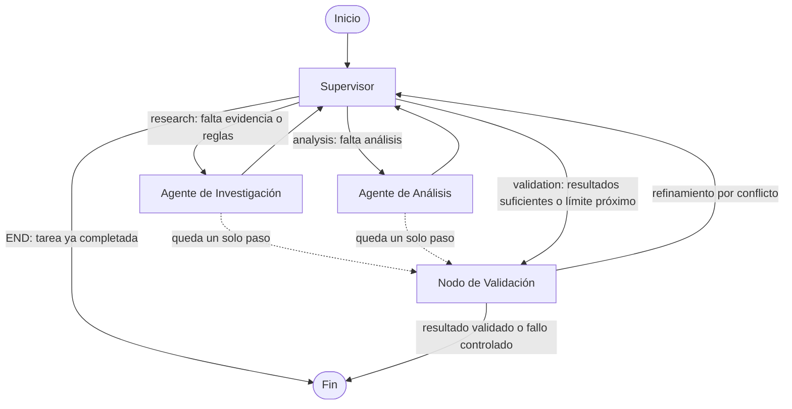
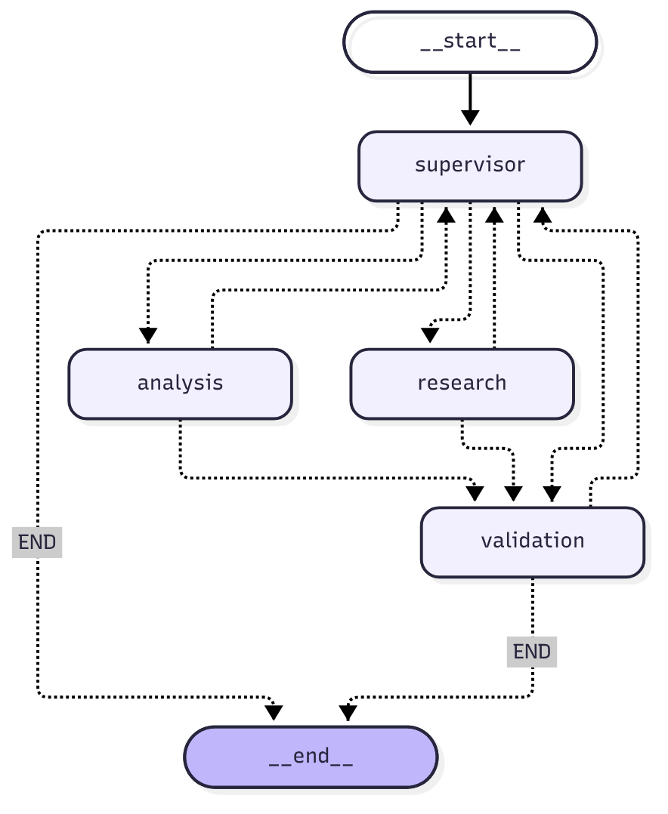

# L10n QA Orchestrator

Orquestador multiagente (Python + LangGraph) que hace **QA estructural y validación de preparación para importación** de archivos JSON traducidos antes de cargarlos en un CMS como Sitecore o Umbraco.

Un **Supervisor** coordina a tres especialistas: **Investigación** (reglas y contexto), **Análisis** (comparación determinista) y **Validación** (coherencia final). Todo corre en local, sin credenciales ni servicios externos.

## Contenido

1. [Qué es y qué problema resuelve](#1-qué-es-y-qué-problema-resuelve)
2. [Fuera de alcance](#2-fuera-de-alcance)
3. [Arquitectura y topología](#3-arquitectura-y-topología)
4. [Responsabilidades de los agentes](#4-responsabilidades-de-los-agentes)
5. [El Supervisor y las aristas condicionales](#5-el-supervisor-y-las-aristas-condicionales)
6. [Estado compartido, contribuciones y aislamiento de contexto](#6-estado-compartido-contribuciones-y-aislamiento-de-contexto)
7. [Validación final, conflictos y bucles infinitos](#7-validación-final-conflictos-y-bucles-infinitos)
8. [Instalación, demostración, pruebas y notebook](#8-instalación-demostración-pruebas-y-notebook)
9. [Cómo interpretar el informe final](#9-cómo-interpretar-el-informe-final)
10. [Limitaciones y mejoras futuras](#10-limitaciones-y-mejoras-futuras)
11. [Estructura del repositorio y publicación en GitHub](#11-estructura-del-repositorio-y-publicación-en-github)

## 1. Qué es y qué problema resuelve

En Localization Engineering, antes de importar contenido traducido a un CMS hay que comprobar que cada archivo localizado respete **la estructura y los requisitos técnicos del origen**. Un placeholder renombrado, una clave faltante, un número convertido en texto o un `\n` literal donde había un salto real pueden romper la importación o el render, aunque la traducción sea perfecta.

Este proyecto automatiza esa revisión comparando cada archivo de origen (p. ej. `home.en.json`) con sus destinos (`home.es.json`, `home.ar.json`) y produce un informe con **errores confirmados, advertencias e información**, cada uno con ruta de archivo, ruta JSON y evidencia verificable.

Controles que realiza:

- Correspondencia de claves (faltantes e inesperadas), recursiva en objetos y arrays anidados.
- Tipos de datos JSON (`string`, `number`, `boolean`, `null`, `array`, `object`).
- Placeholders (`{x}`, `{{x}}`, `${x}`, `%s`, `%d`, `%1$s`): se compara el conjunto, no el orden (importante en árabe, RTL).
- Saltos de línea: distingue el salto **real** de la secuencia **literal** `\n`.
- Metadatos sensibles a la importación (`_gpiInternalData-*`) con **excepciones configurables por clave** (`_gpiInternalData-toolName`, `_gpiInternalData-rootPath`).
- Diferencias legítimas que **no** son error: texto igual al inglés (marcas) o de longitud distinta.

## 2. Fuera de alcance

- **QA lingüístico**: no evalúa gramática, terminología, estilo ni exactitud de la traducción.
- **No modifica archivos**: nunca corrige, completa ni reemplaza traducciones (se verifica con huellas SHA-256 antes y después).
- **No importa nada al CMS**: `PASS` no equivale a una importación real exitosa.
- No usa modelos de lenguaje ni búsqueda web: la investigación consulta una base de conocimiento local (`tools/l10n_rules.py`).

## 3. Arquitectura y topología

Se eligió una **arquitectura jerárquica con Supervisor** (un controlador central y especialistas que siempre le devuelven el control). Es adecuada para este problema porque:

- **Separa responsabilidades**: investigar (qué reglas aplican), analizar (qué difiere) y validar (si el resultado es coherente) son tareas distintas, con herramientas y contextos distintos.
- **Mantiene el control del flujo en un solo lugar**: el Supervisor decide cada paso a partir del estado, puede pedir refinamientos concretos y es quien reserva el último paso para cerrar. Una cadena fija no podría reaccionar a lagunas de cobertura ni a conflictos.
- **Es auditable**: cada decisión queda en `routing_log` con su motivo y cada aporte en `agent_contributions`.
- **Evita bucles**: con un único punto de decisión es simple imponer el límite de ejecución.

Grafo implementado (generado desde el grafo compilado; el diagrama de LangGraph está en [`docs/grafo.mmd`](docs/grafo.mmd) y la imagen en [`docs/grafo.png`](docs/grafo.png)):





Las líneas punteadas son rutas de seguridad: si tras un especialista solo queda una ejecución disponible, se pasa directo a la Validación para cerrar sin superar `max_steps`.

## 4. Responsabilidades de los agentes

| Agente | Archivo | Qué hace | Qué NO hace |
|---|---|---|---|
| **Supervisor** | `agents/supervisor_agent.py` | Decide la ruta (`research`, `analysis`, `validation`, `END`), pide refinamientos, reserva el último paso | No inspecciona ni analiza archivos |
| **Investigación** | `agents/research_agent.py` | Inspecciona archivos, detecta idiomas y pares, deduce los controles pedidos, recupera reglas y excepciones aplicables | No compara estructuras ni modifica archivos |
| **Análisis** | `agents/analyst_agent.py` | Valida sintaxis, compara estructura, tipos, placeholders, saltos de línea y metadatos; genera hallazgos con evidencia | No corrige ni completa traducciones |
| **Validación** | `agents/validation_agent.py` | Comprueba coherencia y completitud, detecta conflictos, calcula el estado y construye el informe | No produce hallazgos nuevos |

Herramientas funcionales (objetos `@tool` de LangChain, ejecutadas sobre archivos reales):

- Investigación: `inspect_localization_files` y `search_l10n_qa_rules` (consulta con puntaje sobre 17 reglas en 8 categorías).
- Análisis: `compare_json_structure`, `check_placeholders_and_newlines` y `validate_rules_and_exceptions`.

## 5. El Supervisor y las aristas condicionales

`decidir_siguiente(state)` es una función pura que evalúa estos criterios **en orden** sobre el estado compartido:

1. Tarea ya completada → `END`.
2. Quedan pocas ejecuciones (reserva el último paso) → `validation`.
3. Solicitud vacía → `validation` (fallo controlado de entrada).
4. Refinamiento pendiente (pedido por la Validación) → el especialista correspondiente.
5. No hay investigación → `research`. Sin archivos → `validation` (fallo controlado).
6. Las reglas recuperadas no cubren las categorías necesarias → `research` con un **refinamiento concreto** (una sola vez).
7. No hay análisis → `analysis`. Faltan controles solicitados que sí tienen regla → refinamiento a `analysis` (una sola vez).
8. Todo suficiente → `validation`.

Los refinamientos llevan una `clave` única registrada en `refinement_log`, por lo que **no se repiten** cuando los resultados ya son suficientes.

El enrutamiento se implementa con `add_conditional_edges` y funciones con anotación `Literal` (ver `graph.py`):

```python
def enrutar_supervisor(state) -> Literal["research", "analysis", "validation", "END"]: ...
def enrutar_tras_especialista(state) -> Literal["supervisor", "validation"]: ...
def enrutar_validacion(state) -> Literal["supervisor", "END"]: ...

g.add_conditional_edges("supervisor", enrutar_supervisor, {"research": "research", "analysis": "analysis",
                                                          "validation": "validation", "END": END})
```

En la ejecución de demostración, el Supervisor produce: `research` → `research` (refinamiento: la primera consulta de reglas no cubre tipos, placeholders, metadatos ni excepciones) → `analysis` → `validation`.

## 6. Estado compartido, contribuciones y aislamiento de contexto

`state.py` define `L10nState`, que **hereda de `MessagesState`** y agrega campos tipados.

| Comportamiento | Campos |
|---|---|
| **Reemplazan** el valor anterior | `user_request`, `source_files`, `target_files`, `validation_results`, `next_agent`, `task_completed`, `max_steps`, `final_report`, `pending_refinement`, `config` |
| **Acumulan** (`Annotated[..., operator.add]`; los nodos devuelven solo lo nuevo) | `research_findings`, `analysis_findings`, `agent_contributions`, `errors`, `uncertainties`, `conflicts`, `refinement_log`, `routing_log` |
| **Suma** | `step_count` (cada nodo devuelve `1`) |
| **Mensajes** | `messages` con el reducer `add_messages` de `MessagesState` |

**Trazabilidad.** Cada nodo agrega una `Contribucion` con: agente responsable, tipo de análisis, ids de hallazgos, evidencias utilizadas (herramientas y reglas), conteo por estado (`confirmed` / `rejected` / `pending`) y la solicitud de refinamiento emitida o atendida. Cada hallazgo de análisis tiene su propio estado: error → `confirmed`, advertencia → `pending`, información → `confirmed`, y `rejected` lo asigna la Validación.

**Aislamiento de contexto.** Los especialistas no reciben el estado completo, sino un contexto mínimo construido por `contexto_investigacion()` y `contexto_analisis()`:

- Investigación: solicitud, rutas, configuración y su propio refinamiento.
- Análisis: solicitud, pares de archivos, reglas (solo id, categoría y título), excepciones aplicables y su refinamiento.
- Ninguno recibe `messages` ni las contribuciones de los demás (hay pruebas que lo verifican). El Supervisor conserva todo el estado para decidir.

## 7. Validación final, conflictos y bucles infinitos

**Validación final** (`validation_node`). Comprueba:

1. Contribuciones necesarias presentes.
2. Estructura válida de los hallazgos (un hallazgo inválido se marca `rejected` y se lista aparte; nunca se descarta).
3. Evidencia reproducible: se vuelven a leer los archivos y se comprueba la presencia/valor/longitud que afirma cada hallazgo.
4. Traducciones intactas: huella SHA-256 de cada archivo igual a la de la inspección y a la de antes y después del análisis.
5. Fidelidad del informe: se recuentan los hallazgos reales y se comparan con lo que afirma el informe.
6. Límite de ejecución respetado.

**Conflictos entre agentes.** Se detectan cuando la investigación y el análisis afirman cosas incompatibles (p. ej. la investigación dice que un archivo es JSON válido y el análisis lo reporta inválido). Entonces:

1. Se **conservan ambas contribuciones** (los registros son acumulativos; nada se elimina).
2. Se registra el conflicto en `conflicts` con ambas versiones.
3. La Validación pide al Supervisor una **investigación específica** (`verificar_archivos`) si hay presupuesto de pasos.
4. Si tras reinvestigar siguen en desacuerdo, el conflicto queda `sin_resolver`, el hallazgo contradictorio se rechaza con motivo y el estado es `NEEDS_REVIEW` (revisión pendiente). Si coinciden, queda `resuelto`.

**Prevención de bucles infinitos.** El límite es de **12 ejecuciones de nodos** por tarea (`max_steps`; mínimo configurable 4). Cada nodo suma 1 a `step_count` y el límite se aplica de forma efectiva:

- El Supervisor reserva el último paso para la Validación.
- Tras un especialista, si solo queda un paso, el grafo va directo a la Validación.
- La Validación solo pide un refinamiento si quedan al menos 4 pasos para completarlo.
- Un refinamiento no se repite (`clave` en `refinement_log`).

Si el análisis no se completó, el cierre es controlado: estado **`INCOMPLETE`**, con lo pendiente explicado. Nunca se presenta como validado. Además, `recursion_limit` de LangGraph se fija en 50 como segunda barrera.

Entradas inválidas (archivo inexistente, vacío, JSON inválido, solicitud vacía, sin archivos, error de una herramienta) producen un informe controlado, no una excepción.

## 8. Instalación, demostración, pruebas y notebook

Requisitos: Python 3.10 o superior (probado únicamente con Python 3.13).

```bash
git clone <URL-del-repositorio> l10n-qa-orchestrator
cd l10n-qa-orchestrator
python -m venv .venv
source .venv/bin/activate          # En Windows: .venv\Scripts\activate
pip install -r requirements.txt
```

**Demostración completa** (solicitud → delegación → informe):

```bash
python demo.py
```

Imprime las decisiones del Supervisor, las contribuciones, los hallazgos, la validación y el informe, y guarda `salida/informe_qa.json`, `salida/informe_qa.md` y `salida/grafo.mmd`.

**Línea de comandos** (con tus propios archivos; códigos de salida: 0 `PASS`, 1 `FAIL`, 2 `NEEDS_REVIEW`, 3 `INCOMPLETE`):

```bash
python main.py --origen fixtures/source --destino fixtures/targets
python main.py --origen fixtures/source/clean.en.json --destino fixtures/targets/clean.es.json
python main.py --solicitud "Verificá únicamente los placeholders" --max-pasos 12
```

La convención de nombres es `<base>.<idioma>.json`; el origen `home.en.json` se empareja con `home.es.json` y `home.ar.json`.

**Pruebas:**

```bash
python -m pytest
```

**Notebook** (ejecutable, con salidas ya guardadas):

```bash
pip install jupyterlab            # opcional, solo para abrirlo en el navegador
jupyter lab notebooks/l10n_qa_demo.ipynb
```

También puede abrirse en VS Code. Ejecutá "Run All": muestra la solicitud, el paso a paso del grafo, el enrutamiento, las contribuciones, los hallazgos, la validación, el informe y el estado final.

**Diagrama del grafo.** `from graph import obtener_mermaid; print(obtener_mermaid())` funciona sin dependencias opcionales. `guardar_diagrama_png()` usa `draw_mermaid_png()` de LangGraph, que necesita acceso a internet (mermaid.ink) o dependencias opcionales; si falla, devuelve `False` y el Mermaid sigue disponible. La imagen `docs/grafo.png` incluida se generó a partir del Mermaid del grafo compilado con `mermaid-cli` local.

## 9. Cómo interpretar el informe final

| Estado | En español | Significado |
|---|---|---|
| `PASS` | APROBADO | Se superaron los controles estructurales configurados. **No** garantiza calidad lingüística ni una importación real exitosa. |
| `FAIL` | FALLIDO | Hay al menos un error estructural confirmado. |
| `NEEDS_REVIEW` | REQUIERE REVISIÓN | Sin errores confirmados, pero hay advertencias, conflictos sin resolver, hallazgos rechazados o verificaciones fallidas. |
| `INCOMPLETE` | INCOMPLETO | No se pudo completar el análisis (límite de pasos, solicitud o archivos inválidos, archivos no analizables). No es un resultado validado. |

Precedencia: `INCOMPLETE` > `FAIL` > `NEEDS_REVIEW` > `PASS`.

Severidades: **`error`** problema estructural confirmado; **`warning`** requiere revisión (estado `pending`); **`info`** diferencia informativa que no es error (excepciones aplicadas y diferencias legítimas).

El informe (`informe_qa.json` / `.md`) incluye: estado general, archivos e idiomas analizados, conteo por severidad, hallazgos agrupados por severidad (con archivo, ruta JSON, explicación y evidencia), reglas y excepciones aplicadas (con su justificación), agentes que contribuyeron, resultado de cada verificación de la validación, conflictos, problemas pendientes y recomendaciones. Siempre aclara que es QA estructural y validación de preparación para importación.

### Excepciones de metadata

Las claves `_gpiInternalData-*` son metadatos sensibles: su valor debe coincidir con el origen. Solo hay excepciones **por clave explícita**, definidas en `CONFIG_POR_DEFECTO` (`tools/l10n_rules.py`): `_gpiInternalData-toolName` (EXC-001) y `_gpiInternalData-rootPath` (EXC-002). Un valor distinto en una clave con excepción se informa como `info` y se documenta en el informe; en cualquier otra clave `_gpiInternalData-*` es un `error`. Podés agregar excepciones pasando un `config` propio a `crear_estado_inicial`.

## 10. Limitaciones y mejoras futuras

**Limitaciones reales del prototipo**

- Solo archivos JSON con la convención `<base>.<idioma>.json`; no soporta XLIFF, PO, RESX ni otros formatos.
- La semántica de los metadatos `_gpiInternalData-*` (valor igual al origen, salvo excepciones) y los umbrales informativos (longitud fuera de 0,7–1,4 veces) son **supuestos del prototipo**; deben ajustarse a las reglas reales de cada CMS.
- Las rutas JSON usan notación `a.b[0].c`: las claves que contienen puntos o corchetes no se pueden resolver al reproducir la evidencia.
- Los placeholders reconocidos son `{x}`, `{{x}}`, `${x}`, `%s`, `%d`, `%1$s`; no se analizan etiquetas HTML ni sintaxis ICU (`plural`, `select`).
- Los hallazgos de tipo `info` (diferencias legítimas) se resumen por archivo, no clave por clave.
- La investigación es una búsqueda por palabras clave sobre 17 reglas locales; no hay búsqueda semántica ni consulta de documentación externa.
- Los agentes son deterministas (no hay LLM). La delegación es real y dependiente del estado, pero la "inteligencia" está en reglas explícitas.
- La publicación a GitHub no se hizo desde este entorno (ver sección siguiente).

**Mejoras posibles**: soporte de más formatos (XLIFF, PO, RESX), reglas ICU y HTML, carga de excepciones desde un archivo YAML por proyecto, integración opcional de un LLM para redactar recomendaciones o resolver conflictos, persistencia con *checkpointers* de LangGraph, ejecución en paralelo por par de archivos, e integración con CI para bloquear importaciones con `FAIL`.

## 11. Estructura del repositorio y publicación en GitHub

```text
l10n-qa-orchestrator/
├── agents/
│   ├── supervisor_agent.py     # Supervisor: decisión de ruta y refinamientos
│   ├── research_agent.py       # Agente de Investigación
│   ├── analyst_agent.py        # Agente de Análisis
│   └── validation_agent.py     # Nodo de Validación final y conflictos
├── tools/
│   ├── file_inspector.py       # inspect_localization_files y lectura segura de JSON
│   ├── l10n_rules.py           # base de conocimiento, excepciones, search_l10n_qa_rules
│   └── structural_validator.py # herramientas de comparación y validación
├── fixtures/                   # source/, targets/, expected_results/ y README de defectos
├── notebooks/l10n_qa_demo.ipynb
├── tests/                      # pytest: investigación, análisis, grafo, validación, end-to-end
├── docs/                       # grafo.mmd y grafo.png
├── state.py                    # L10nState (hereda de MessagesState) y utilidades
├── graph.py                    # StateGraph y aristas condicionales
├── report.py                   # informe JSON y Markdown
├── main.py                     # CLI
├── demo.py                     # demostración completa
├── requirements.txt · .env.example · .gitignore · pytest.ini
```

Para publicar el repositorio local (ya inicializado con `git`):

```bash
gh auth login
gh repo create l10n-qa-orchestrator --private --source=. --remote=origin --push
# o, con un repositorio vacío creado en la web:
git remote add origin https://github.com/<usuario>/l10n-qa-orchestrator.git
git push -u origin main
```
